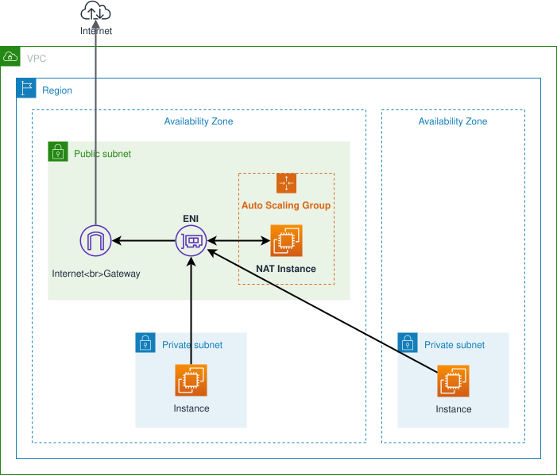

# terraform-aws-nat-instance [](https://circleci.com/gh/int128/terraform-aws-nat-instance)

This is a Terraform module which provisions a NAT instance.

Features:

- Providing NAT for private subnet(s)
- Auto healing using an auto scaling group
- Saving cost using a spot instance (from $1/month)
- Fixed source IP address by reattaching ENI
- Supporting Systems Manager Session Manager
- Compatible with workspaces

Terraform 0.12 or later is required.

**Warning**: Generally you should use a NAT gateway. This module provides a very low cost solution for testing purpose.


## Getting Started

You can use this module with [terraform-aws-modules/vpc/aws](https://registry.terraform.io/modules/terraform-aws-modules/vpc/aws) module as follows:

```tf
module "vpc" {
  source  = "terraform-aws-modules/vpc/aws"

  name                 = "main"
  cidr                 = "172.18.0.0/16"
  azs                  = ["us-west-2a", "us-west-2b", "us-west-2c"]
  private_subnets      = ["172.18.64.0/20", "172.18.80.0/20", "172.18.96.0/20"]
  public_subnets       = ["172.18.128.0/20", "172.18.144.0/20", "172.18.160.0/20"]
  enable_dns_hostnames = true
}

module "nat" {
  source = "int128/nat-instance/aws"

  name                        = "main"
  vpc_id                      = module.vpc.vpc_id
  public_subnet               = module.vpc.public_subnets[0]
  private_subnets_cidr_blocks = module.vpc.private_subnets_cidr_blocks
  private_route_table_ids     = module.vpc.private_route_table_ids
}

resource "aws_eip" "nat" {
  network_interface = module.nat.eni_id
  tags = {
    "Name" = "nat-instance-main"
  }
}
```

Now create an EC2 instance in the private subnet to verify the NAT configuration.
Open the [AWS Systems Manager Session Manager](https://docs.aws.amazon.com/systems-manager/latest/userguide/session-manager.html), log in to the instance and make sure you have external access from the instance.

See also the [example](example/).


## How it works

This module provisions the following resources:

- Auto Scaling Group with mixed instances policy
- Launch Template
- Elastic Network Interface
- Security Group
- IAM Role for SSM and ENI attachment
- VPC Route (optional)

You need to attach your elastic IP to the ENI.

Take a look at the diagram:



By default the latest Amazon Linux 2 image is used.
You can set `image_id` for a custom image.

The instance will execute [`runonce.sh`](runonce.sh) and [`snat.sh`](snat.sh) to enable NAT as follows:

1. Attach the ENI to `eth1`.
1. Set the kernel parameters for IP forwarding and masquerade.
1. Masquerade on `eth0`, and with `egress_via_eip` (the default) on `eth1` too, then route forwarded traffic,
   which enters on `eth1`:
   - while `eth1` has a public IP (your Elastic IP): out of `eth1` through a policy rule (`iif eth1`,
     table 200), so it leaves from the Elastic IP
   - otherwise, or without `egress_via_eip`: out of `eth0`, from its auto-assigned public IP, which changes
     whenever the instance is replaced

   With `egress_via_eip`, [`egress-route.sh`](egress-route.sh) makes that choice at boot and every 15 seconds
   after (`nat-egress-route.timer`): an Elastic IP associated after boot is picked up, a removed one falls
   back to `eth0`, and the rule and route are restored when the network scripts drop them (ec2-net-utils
   refresh, DHCP renewal). The instance's own traffic keeps using `eth0` while it has a public IP.

Allowlisting the Elastic IP on an external service therefore requires `egress_via_eip`. Each change of egress
interface and each repair is logged by `egress-route.sh` (`journalctl -u nat-egress-route`).

Traffic leaves from the Elastic IP on the ENI's primary private IP. With `single_eip` (the default) that
is the only one and nothing else is looked up. With several Elastic IPs on the ENI (one per private IP),
set `single_eip = false` and `egress_public_ip` to pick another: traffic is then SNATed to the private
IP that Elastic IP is associated with. An address not associated with the ENI is logged and ignored.

### No public IP on the instance

By default `runonce.sh` attaches the ENI itself through the EC2 API, which needs `eth0`'s public IP: until
`eth1` is attached, that is the instance's only way out. With `associate_public_ip_address = false` (or
`attach_eni_from_lifecycle_hook = true`) the ENI is attached from outside instead
([`lifecycle-hook.tf`](lifecycle-hook.tf)):

1. An ASG launch lifecycle hook (`attach-eni`) holds each new instance in `Pending:Wait`.
1. An EventBridge rule on that lifecycle event starts an SSM Automation runbook (`<name>-attach-eni`), which
   waits for the instance to run and the ENI to be free, disables the source/dest check, attaches the ENI as
   `eth1`, and completes the hook with `CONTINUE`. On any failure it completes it with `ABANDON` (as does a
   15-minute timeout), so the ASG launches another instance.
1. Without a public IP, the instance's own traffic (SSM, package updates) also leaves through `eth1` and its
   Elastic IP: `egress-route.sh` keeps the main default route on `eth1`. Amazon Linux's boot-time security
   update (`repo_upgrade`) is turned off, as it would stall before that route exists.

This needs `egress_via_eip` (the Elastic IP on the ENI is the only way out) and adds no running cost: no
Lambda, only the hook, rule, runbook and two IAM roles. Runbook executions are under Systems Manager >
Automation.


## Configuration

### User data

You can set additional `write_files` and `runcmd` section. For example,

```tf
module "nat" {
  user_data_write_files = [
    {
      path : "/opt/nat/run.sh",
      content : file("./run.sh"),
      permissions : "0755",
    },
  ]
  user_data_runcmd = [
    ["/opt/nat/run.sh"],
  ]
}
```

See also [cloud-init modules](https://cloudinit.readthedocs.io/en/latest/topics/modules.html) and the [example](example/) for more.


### SSH access

You can enable SSH access by setting `key_name` option and opening the security group. For example,

```tf
module "nat" {
  key_name = "YOUR_KEY_PAIR"
}

resource "aws_security_group_rule" "nat_ssh" {
  security_group_id = module.nat.sg_id
  type              = "ingress"
  cidr_blocks       = ["0.0.0.0/0"]
  from_port         = 22
  to_port           = 22
  protocol          = "tcp"
}
```


## Migration guide

### Upgrade to v2 from v1

This module no longer creates an EIP since v2.

To keep your EIP when you migrate to module v2, rename the EIP in the state as follows:

```console
% terraform state mv -dry-run module.nat.aws_eip.this aws_eip.nat
Would move "module.nat.aws_eip.this" to "aws_eip.nat"

% terraform state mv module.nat.aws_eip.this aws_eip.nat
Move "module.nat.aws_eip.this" to "aws_eip.nat"
Successfully moved 1 object(s).
```


## Contributions

This is an open source software. Feel free to open issues and pull requests.


<!--terraform-docs-->
## Requirements

No requirements.

## Providers

| Name | Version |
|------|---------|
| aws | n/a |

## Inputs

| Name | Description | Type | Default | Required |
|------|-------------|------|---------|:--------:|
| single\_eip | Only one Elastic IP is associated with the ENI: egress masquerades on its primary private IP and the egress\_public\_ip lookup is skipped. Set false to pick among several Elastic IPs with egress\_public\_ip | `bool` | `true` | no |
| egress\_public\_ip | Only with single\_eip = false: of several Elastic IPs on the ENI, the one to send traffic from. It must be associated with one of the ENI's private IPs. Empty: the Elastic IP of the ENI's primary private IP | `string` | `""` | no |
| associate\_public\_ip\_address | Whether to associate a public ip address with the instance (eth0). false turns on attach\_eni\_from\_lifecycle\_hook: without it the instance could not reach the EC2 API to attach the ENI | `bool` | `true` | no |
| attach\_eni\_from\_lifecycle\_hook | Attach the ENI from outside the instance (ASG launch lifecycle hook -> EventBridge -> SSM Automation) instead of from runonce.sh. Always on with associate\_public\_ip\_address = false | `bool` | `false` | no |
| egress\_via\_eip | Send NAT traffic out through the ENI (eth1) when it has a public IP, i.e. an Elastic IP is associated with it, so it leaves from that stable address instead of the instance's auto-assigned public IP. Without a public IP on the ENI, traffic keeps leaving through eth0 | `bool` | `true` | no |
| enabled | Enable or not costly resources | `bool` | `true` | no |
| image\_id | AMI of the NAT instance. Default to the latest Amazon Linux 2 | `string` | `""` | no |
| instance\_types | Candidates of spot instance type for the NAT instance. This is used in the mixed instances policy | `list` | <pre>[<br>  "t3.nano",<br>  "t3a.nano"<br>]</pre> | no |
| key\_name | Name of the key pair for the NAT instance. You can set this to assign the key pair to the NAT instance | `string` | `""` | no |
| name | Name for all the resources as identifier | `string` | n/a | yes |
| private\_route\_table\_ids | List of ID of the route tables for the private subnets. You can set this to assign the each default route to the NAT instance | `list` | `[]` | no |
| private\_subnets\_cidr\_blocks | List of CIDR blocks of the private subnets. The NAT instance accepts connections from this subnets | `list` | n/a | yes |
| public\_subnet | ID of the public subnet to place the NAT instance | `string` | n/a | yes |
| tags | Tags applied to resources created with this module | `map` | `{}` | no |
| use\_spot\_instance | Whether to use spot or on-demand EC2 instance | `bool` | `true` | no |
| user\_data\_runcmd | Additional runcmd section of cloud-init | `list` | `[]` | no |
| user\_data\_write\_files | Additional write\_files section of cloud-init | `list` | `[]` | no |
| vpc\_id | ID of the VPC | `string` | n/a | yes |

## Outputs

| Name | Description |
|------|-------------|
| eni\_id | ID of the ENI for the NAT instance |
| eni\_private\_ip | Private IP of the ENI for the NAT instance |
| iam\_role\_name | Name of the IAM role for the NAT instance |
| sg\_id | ID of the security group of the NAT instance |

